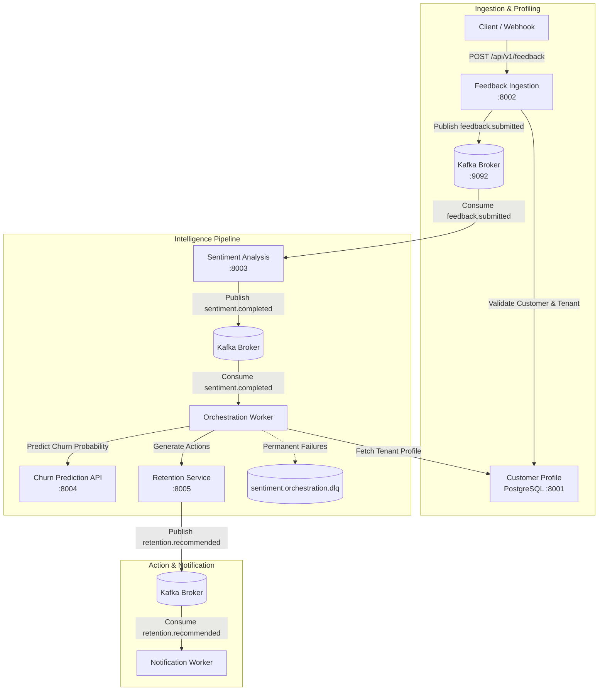

# AI-Powered Customer Intelligence & Churn Prediction Platform

An event-driven, multi-tenant microservices platform that analyzes customer feedback in real time, assesses churn risk using a trained machine learning pipeline, and generates proactive customer retention strategies.

---

## Architecture Overview

The system is built on an event-driven architecture using **Apache Kafka**, **FastAPI**, **PostgreSQL**, **SQLite**, and **Scikit-learn**.



---

## Services & Ports

| Service | Port | Database / Storage | Description |
| :--- | :--- | :--- | :--- |
| **Customer Profile** | `8001` | PostgreSQL 17 (`customer_profiles`) | Multi-tenant customer store managing subscription plans, spend, tenure, and activity. |
| **Feedback Ingestion** | `8002` | SQLite (`feedback.db`) | Ingests feedback, validates tenant boundaries via Customer Profile, and publishes events. |
| **Sentiment Analysis** | `8003` | SQLite (`sentiment.db`) | Background worker scoring text sentiment (VADER) and publishing completion events. |
| **Churn Prediction** | `8004` | Joblib Model Artifact | ML inference service predicting churn probability using SaaS engagement features. |
| **Retention Service** | `8005` | Stateless (Rules Engine) | Evaluates churn probability, plan tier, support ticket volume, and sentiment to recommend retention actions. |
| **Orchestrator** | *Worker* | Kafka Consumer/Producer | Event pipeline coordinator mapping customer profiles to ML features with DLQ error handling. |
| **Notification Worker** | *Worker* | Kafka Consumer | Consumes retention recommendation events and logs dispatch notifications. |
| **Kafka Broker** | `29092` / `9092` | KRaft Mode (Broker + Controller) | Event backbone for real-time inter-service streaming. |
| **PostgreSQL DB** | `5433` (host) / `5432` | Volume `postgres_data` | Persistent relational store for tenant and customer profile records. |

---

## Key Features

- **Multi-Tenant Boundary Enforcement**: Every feedback submission strictly validates `tenant_id` and `customer_id` against the Customer Profile service before persistence.
- **SaaS Churn Machine Learning Model**: Scikit-learn classification pipeline trained on account age, monthly spend, support tickets, login recency, and subscription tier (`free`, `starter`, `professional`, `enterprise`).
- **Resilient Orchestration with DLQ**: The orchestrator classifies failures into transient retries (network blips, 5xx) and permanent failures (missing fields, invalid plan tiers), automatically routing bad data to `sentiment.orchestration.dlq`.
- **Explainable Rule-Based Retention**: Avoids black-box LLM decisions for business actions; maps risk thresholds ($\ge 0.70$ high, $\ge 0.40$ medium, $< 0.40$ low) and engagement signals to concrete customer-success playbooks.

---

## Getting Started

### Prerequisites

- [Docker Desktop](https://www.docker.com/products/docker-desktop/) (with Docker Compose v2+)
- Python 3.12+ (for local development or running tests)
- PowerShell or Bash terminal

### 1. Environment Setup

Copy `.env.example` to `.env`:

```bash
cp .env.example .env
```

Verify your `.env` contains:
```env
POSTGRES_DB=customer_profiles
POSTGRES_USER=customer_app
POSTGRES_PASSWORD=local_dev_password_change_me
DATABASE_URL=postgresql+psycopg://customer_app:local_dev_password_change_me@db:5432/customer_profiles
```

### 2. Start the Platform

Launch all containers:

```bash
docker compose up -d --build
```

Verify all services are up and healthy:

```bash
docker compose ps
```

---

## End-to-End Verification Walkthrough

Follow these steps to trace a complete customer event through the system.

### Step 1: Create a Customer Profile

Create a customer belonging to tenant `3fa85f64-5717-4562-b3fc-2c963f66afa6`:

```powershell
$customer = @{
    tenant_id = "3fa85f64-5717-4562-b3fc-2c963f66afa6"
    external_id = "cust-enterprise-01"
    subscription_plan = "professional"
    tenure_months = 14
    monthly_spend = 99.00
    support_tickets_90d = 4
    last_active_at = (Get-Date).ToUniversalTime().ToString("yyyy-MM-ddTHH:mm:ssZ")
} | ConvertTo-Json

$custResp = Invoke-RestMethod -Uri "http://localhost:8001/api/v1/customers" -Method Post -ContentType "application/json" -Body $customer
$customerId = $custResp.id
Write-Host "Created Customer ID: $customerId"
```

### Step 2: Submit Customer Feedback

Submit feedback using the generated `customerId` and `tenant_id`:

```powershell
$feedback = @{
    tenant_id = "3fa85f64-5717-4562-b3fc-2c963f66afa6"
    customer_id = $customerId
    message = "The product is great, but we encountered recurring ticket delays that need attention."
    channel = "web"
} | ConvertTo-Json

Invoke-RestMethod -Uri "http://localhost:8002/api/v1/feedback" -Method Post -ContentType "application/json" -Body $feedback | ConvertTo-Json
```

### Step 3: Inspect Event Processing Across Services

1. **Sentiment Worker:**
   ```powershell
   docker compose logs --tail=10 sentiment-analysis
   ```
   *Logs confirm sentiment analysis score and event publication to `sentiment.completed` with `tenant_id`.*

2. **Orchestrator Worker:**
   ```powershell
   docker compose logs --tail=10 orchestrator
   ```
   *Logs confirm customer lookup, SaaS feature extraction, churn inference, and retention call:*
   ```text
   [INFO] orchestrator: Completed pipeline: feedback=... tenant=... customer=... churn_probability=... risk=...
   ```

3. **Notification Worker:**
   ```powershell
   docker compose logs --tail=10 notification-worker
   ```
   *Logs confirm dispatch of recommended retention actions:*
   ```text
   [INFO] notification_worker: NOTIFICATION | customer=... | risk=... | actions=Review recent support tickets and resolve recurring issues.
   ```

---

## Machine Learning Pipeline

The churn model is trained on synthetic SaaS account metrics with the following 5 features:

- `account_age_days`: Account age derived from `tenure_months * 30`
- `monthly_price_usd`: Current monthly spend
- `support_tickets_90d`: Tickets raised in the trailing 90 days
- `days_since_last_login`: Inactivity days derived from `last_active_at`
- `plan_tier`: Subscription tier (`free`, `starter`, `professional`, `enterprise`)

To retrain the model inside the container runtime:

```bash
docker compose run --rm -v "${PWD}/services/churn_prediction:/workspace" -w /workspace churn-prediction python train.py
```

---

## Health Checks

| Service | Endpoint | Expected Status |
| :--- | :--- | :--- |
| Customer Profile | `GET http://localhost:8001/health` | `{"status": "ok", "service": "customer-profile"}` |
| Feedback Ingestion | `GET http://localhost:8002/health` | `{"status": "ok", "service": "feedback-ingestion"}` |
| Sentiment Analysis | `GET http://localhost:8003/health` | `{"status": "ok", "service": "sentiment-analysis"}` |
| Churn Prediction | `GET http://localhost:8004/health` | `{"status": "ok", "service": "churn-prediction", "model_loaded": true, "model_type": "saas"}` |
| Retention Service | `GET http://localhost:8005/health` | `{"status": "ok", "service": "retention"}` |

---

## Running Automated Tests

Run unit and integration test suites:

```bash
pytest tests/ -v
```
